# SSBOM Manager 使用指南 (v1.0.7)

本文根据对机种代码 **110C3M3AK0**（Model Virgo）的一次实际操作，说明软件的各项功能。截图均在该次操作中直接从软件截取。在 v1.0.6 上拍摄的截图，状态栏显示 v1.0.6；这些步骤的操作和界面在 v1.0.7 中没有变化。

软件界面文字为越南语。本文按界面原样引用按钮名称，并附上说明。

在 HTML 版本中，可使用页面顶部的语言切换按钮和**左侧菜单**跳转到各个章节。

## 1. 安装与更新

### 1.1 首次安装

运行以下安装程序：

```
\\fstvn01.kdtvn.local\Data\00_KDTVN Common(KDTVN共通)\⑤Production Engineering(製造技術)\Hang muc can luu\Vinh\Pm_sosanhBOM\SSBOM_Manager_Setup_1.0.8.exe
```

安装后启动软件。版本号显示在窗口右下角（v1.0.8）。

### 1.2 通过 LAN 更新

当 LAN 上的 `release_update` 文件夹中有更新的版本时，软件会弹出 "Có Phiên Bản Mới Sẵn Sàng!"（有新版本）对话框，显示当前版本、新版本、安装包大小和更新内容。点击 "Tải & Cập Nhật Ngay"（立即更新）进行更新，或点击 "Để sau"（稍后）。

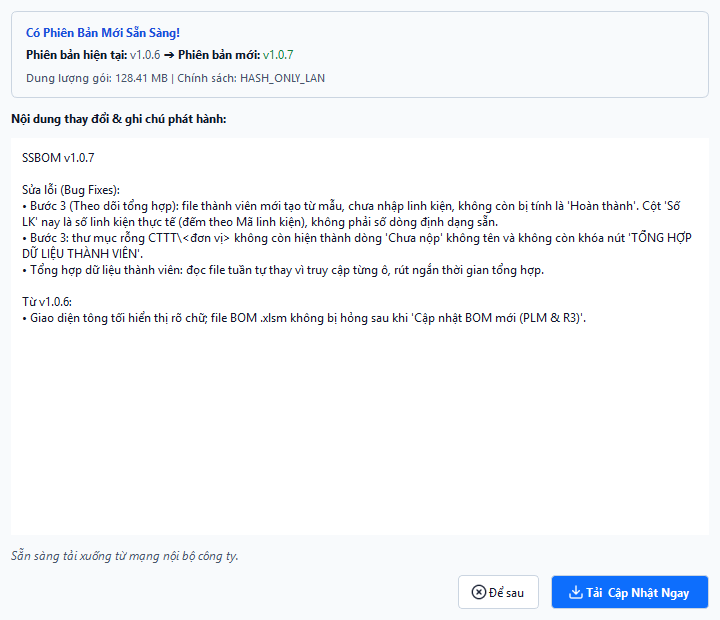

此图是用真实的 1.0.7 安装包信息打开对话框后截取的（为便于说明，当前版本写为 v1.0.6）。编写本文时未重新执行自动下载和安装。

## 2. 示例使用的数据

使用示例文件 `C3MAKO - Copy.zip`：

| 文件 | 内容 |
|---|---|
| `PLM_110C3M3AK0.xlsx` | 从 PLM (Teamcenter) 导出的 BOM，1890 行 |
| `BOM_110C3M3AK0.xlsm` | 事先做好的示例 BOM。其 CTTT 工作表（2198 行）和 R3 工作表被用作示例的输入数据 |

注意事项：

- 编写本文时未连接 Teamcenter 和 SAP，因此示例中的 R3 文件是从示例 BOM 的 R3 工作表导出的，不是直接从 SAP 导出的文件。
- 9 名负责人的 CTTT 数据取自示例 BOM 的 CTTT 工作表。示例中的旧账号名被对应到当前人员名单中的账号（例如 `AnQuyDuong` → `Duong_mecha1.2`）。该对应是文档作者的假设，仅用于试运行。
- 示例的工作目录为 `sample_data\run` 和 `sample_data\run_feat`（试用副本，不是真实数据）。
- 设置类对话框的截图中，真实的账号和密码已替换为占位符。

## 3. 界面概览

主窗口有顶部工具栏和两个界面："Trưởng Nhóm"（组长）和 "Thành Viên Công Đoạn"（工序成员）。

工具栏按钮："Tải BOM (PLM/SAP)"、"Quản lý Bộ lọc BOM PLM"、"Áp dụng bộ lọc cho file có sẵn"、"Cập nhật BOM mới (PLM & R3)"、"Quản lý Trưởng nhóm"、"Nhập liệu Thành viên"、"Giao diện: Sáng [Ctrl+T]"。

### 3.1 明亮与暗色主题

点击工具栏的 "Giao diện" 按钮或按 `Ctrl+T` 切换。也可在 "Cấu hình hệ thống" 的 "Giao diện (UI Theme)" 标签页中选择。切换立即生效，无需重启。

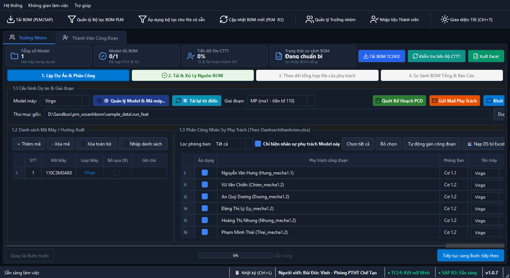

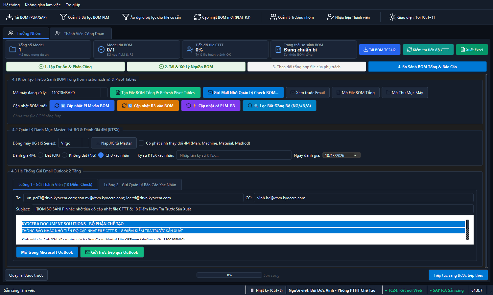

### 3.2 系统设置

通过菜单 "Hệ thống" → "Cấu hình hệ thống"（快捷键 `Ctrl+,`）打开。共有 5 个标签页。

**Teamcenter TC24：** 门户 URL、账号、密码、浏览器、无界面运行 (Headless)、等待时间。带 "Kiểm tra kết nối TC24"（检查连接）按钮。

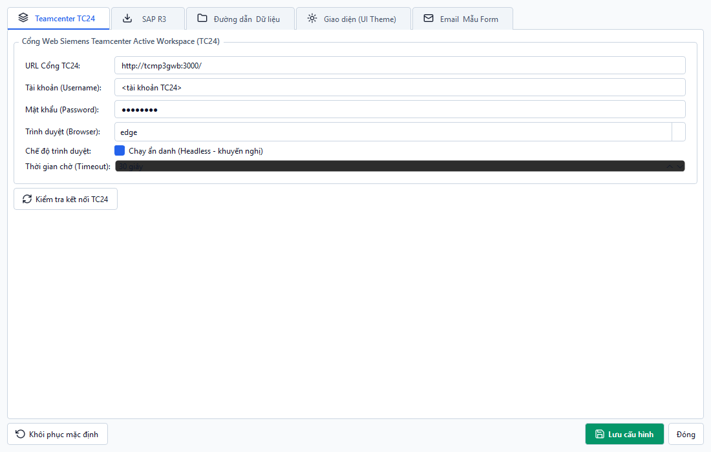

**SAP R3：** System Description、SAP Client、SAP 账号和密码、语言、Plant、BOM Usage、Alternative、`saplogon.exe` 路径。带 "Kiểm tra kết nối SAP GUI" 按钮。

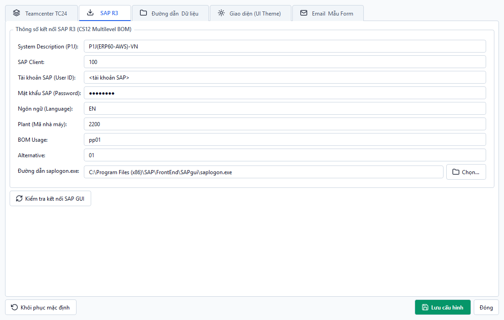

**Đường dẫn Dữ liệu（路径）：** 项目根目录、Master Fix Serial Tool 文件、报告输出目录、共用人员数据库 (SQLite)、LAN 更新目录。

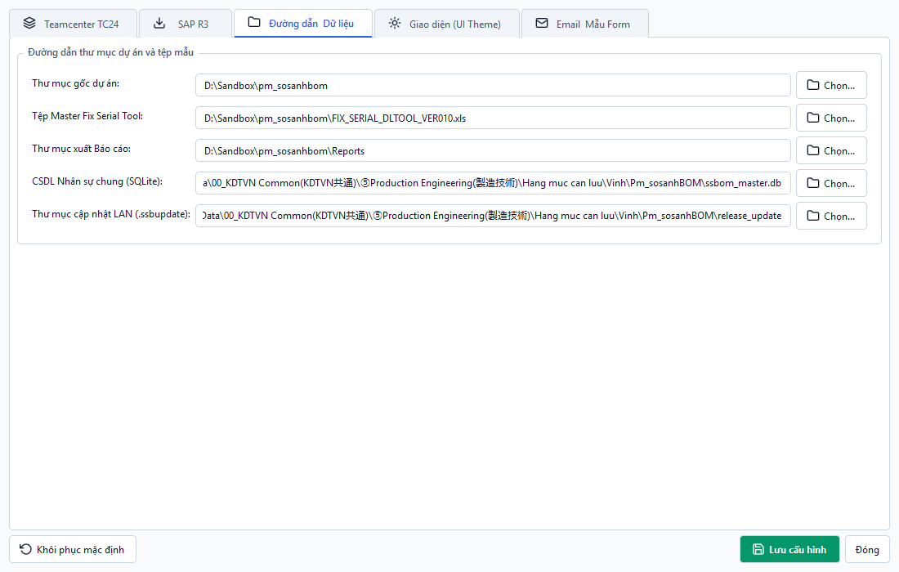

**Giao diện (UI Theme)：** 选择明亮或暗色主题。

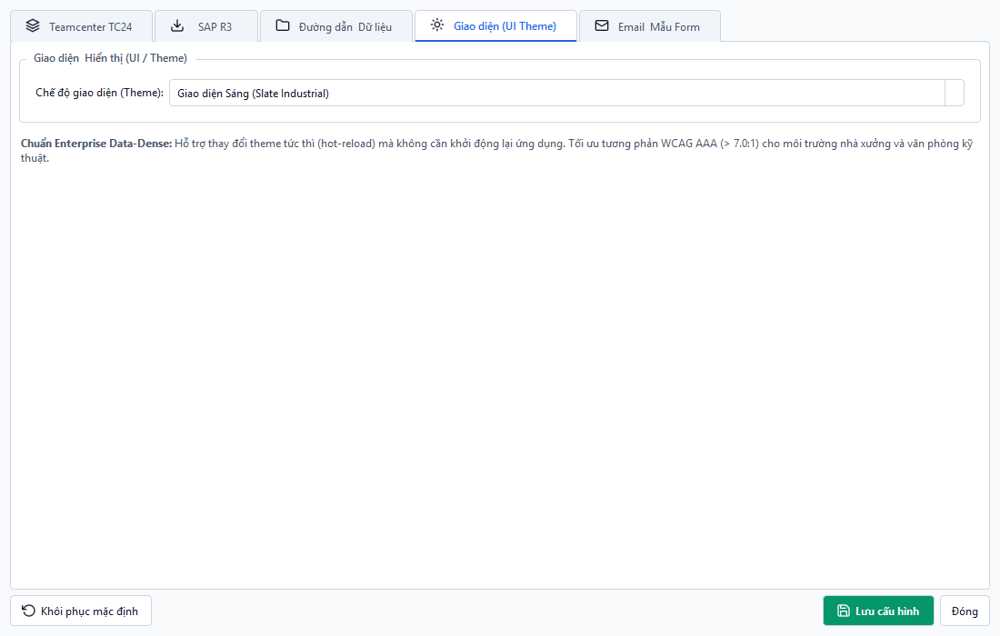

**Email Mẫu Form：** "Chế độ Thử nghiệm"（测试模式）、测试收件人、默认发件人，以及 LAN 上模板文件的路径（机种字典、`formnguoidung.xlsm`、`form_ssbom.xlsm`）。

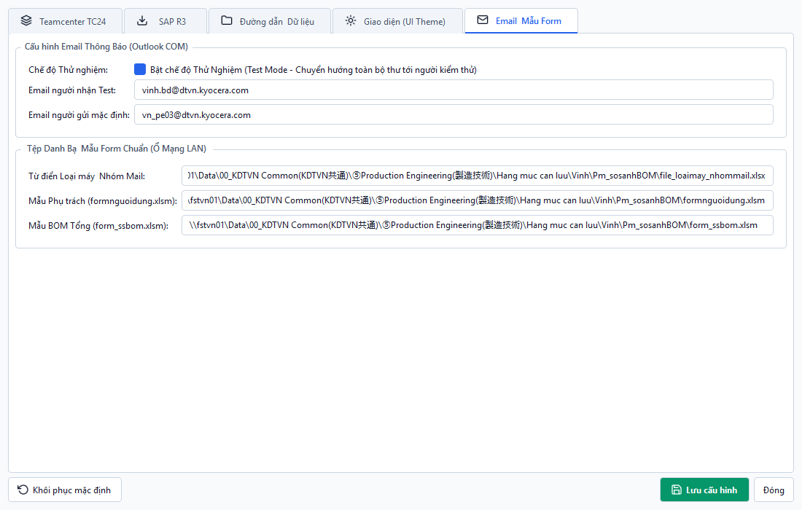

测试模式开启时，所有邮件都会转发给测试人员，而不是发给真实收件人（见 4.5、4.17 和第 6 节）。正式使用时需关闭。

## 4. 组长的操作流程

"Trưởng Nhóm" 界面有 4 个标签页："1. Lập Dự Án & Phân Công"（建立项目与分工）、"2. Tải & Xử Lý Nguồn BOM"（获取并处理 BOM 来源）、"3. Theo dõi tổng hợp file của phụ trách"（跟踪负责人文件）、"4. So Sánh BOM Tổng & Báo Cáo"（汇总 BOM 比较与报告）。

### 4.1 步骤 1. 建立项目与分工

1. 在 "Model máy" 选择 `Virgo`。机种代码 `110C3M3AK0` 在 "1.2 Danh sách Mã Máy" 表中。根目录设为 `sample_data\run`。
2. 在 "1.3 Phân Công Nhân Sự Phụ Trách" 表中选择 9 名负责人，并分配工序（DRUM、LSU、DLP、IMAGE、FUSER、DP、ISU、HONTAI、FRAME UNIT）。
3. 点击 "Khởi Tạo Thư Mục && Phân Công"。

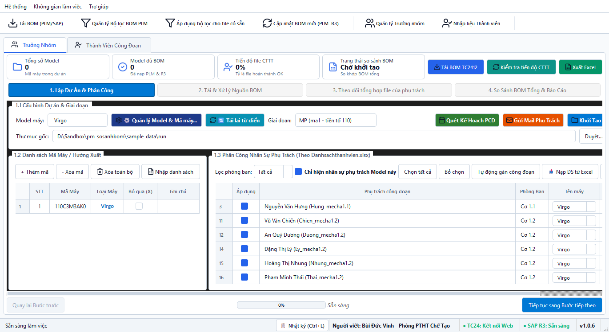

软件提示：

> Đã tạo xong danh sách BOM và các gói file CTTT của phụ trách được phân lập theo từng dòng máy: Model 'Virgo': 1 mã máy
> Cấu trúc: <Thư mục gốc>\<Tên Model>\<Mã máy>\<Tên phụ trách>.xlsm

（含义：已按机种生成负责人的 CTTT 文件包。结构为 <根目录>\<Model 名>\<机种代码>\<负责人名>.xlsm）

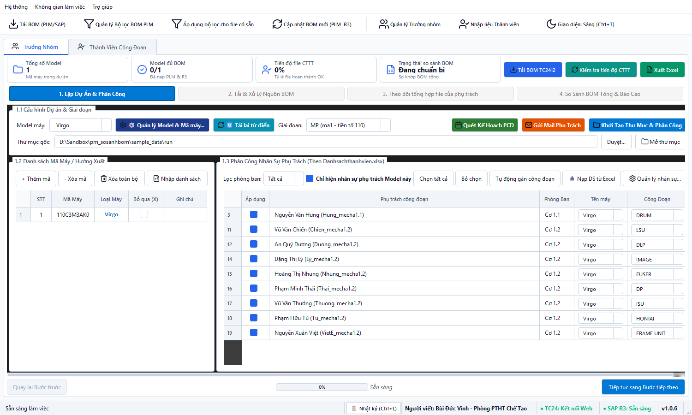

在 `Virgo\110C3M3AK0\` 中生成 9 个 `<账号>.xlsm`（Chien_mecha1.2、Duong_mecha1.2、Hung_mecha1.1、Ly_mecha1.2、Nhung_mecha1.2、Thai_mecha1.2、Thuong_mecha1.2、Tu_mecha1.2、VietE_mecha1.2）。这些文件复制自 `formnguoidung.xlsm`。

### 4.2 管理 Model 与机种代码

点击 1.1 中的 "Quản lý Model & Mã máy..."。对话框分三部分：选择 Model 和生产阶段；该 Model 已登记的 4 位机种代码列表（例如 Virgo 有 10 个）；各部门负责人邮件组（To、CC1、CC2…）。按钮："Tạo Model Mới"（新建 Model）、"Tải lại Excel"、"+ Bổ sung mã vào Model"、"Lưu Nhóm Mail Vào Từ Điển"、"Đưa Danh Sách Mã Này Vào Bảng 1.2"、"Chọn Model Này"。

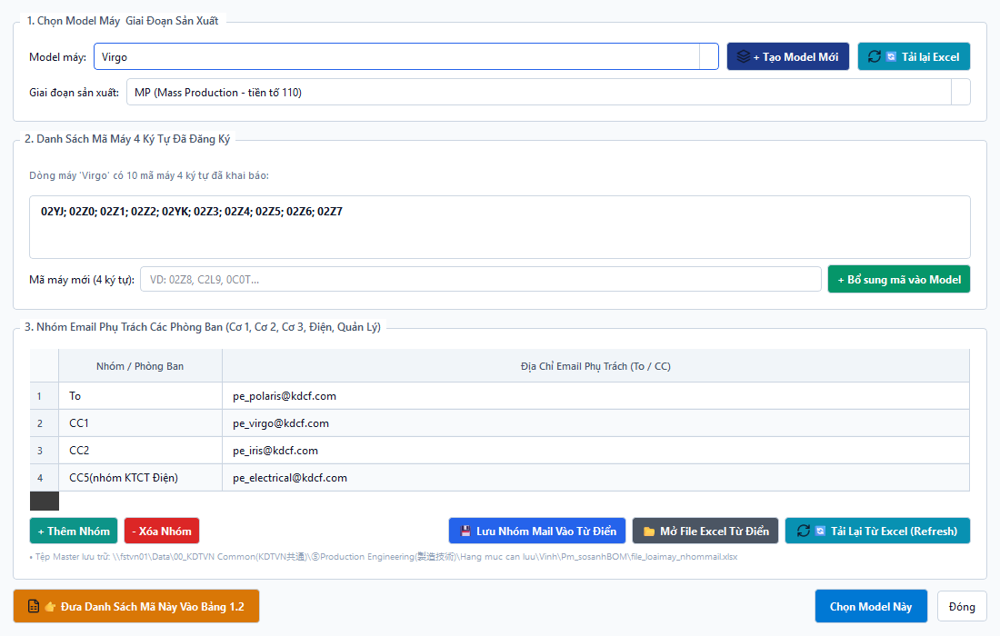

### 4.3 人员管理

点击 1.3 中的 "Quản lý nhân sự..."。"Danh mục Nhân sự Kỹ thuật Sản xuất"（生产技术人员名册）列出成员（示例中为 47 人），可按姓名或账号搜索、按部门筛选，并有 "Chỉ đang hoạt động"（仅在岗）筛选。右侧详细信息表单带有 "+ Thêm thành viên mới"、"Cập nhật thông tin"、"Xóa thành viên"、"Làm mới ô nhập" 按钮。下方有 "Đồng bộ & Nạp lại từ CSDL"、"Nạp lại từ Excel (Refresh)"、"Ghi sang Danhsachthanhvien.xlsm"、"Mở File Excel"。共用数据保存在网络数据库 `ssbom_master.db` 中。

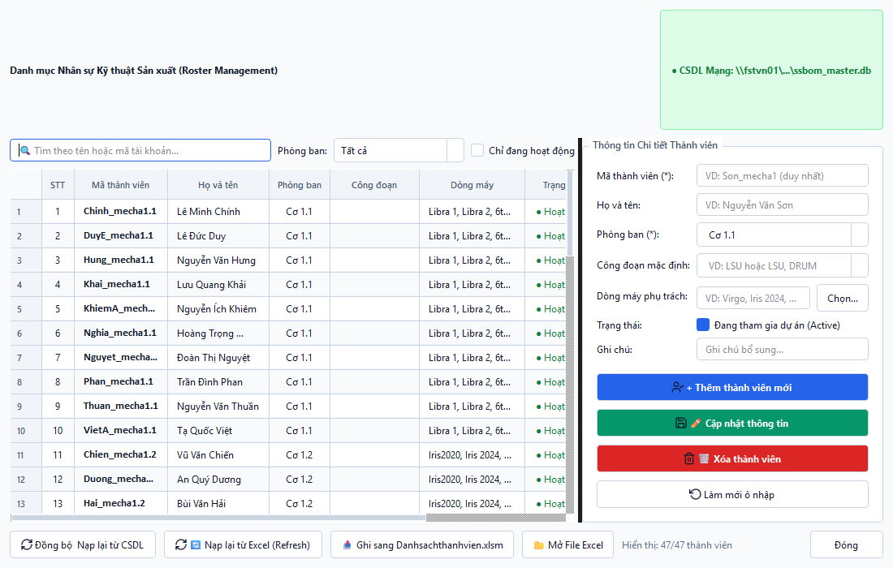

### 4.4 扫描 PCD 计划

点击 1.1 中的 "Quét Kế Hoạch PCD"。对话框分三部分：月度生产计划信息（年、月、计划 Excel 文件；按钮 "Tải Tự Động Từ SharePoint"、"Mở SharePoint PCD..."、"Quét Dữ Liệu"）；找到的新机种代码列表；创建文件夹与邮件通知设置。最下方的 "Khởi Tạo Thư Mục & Sinh Gói File Làm Việc Cho Mã Đã Chọn" 为所选代码创建文件夹。

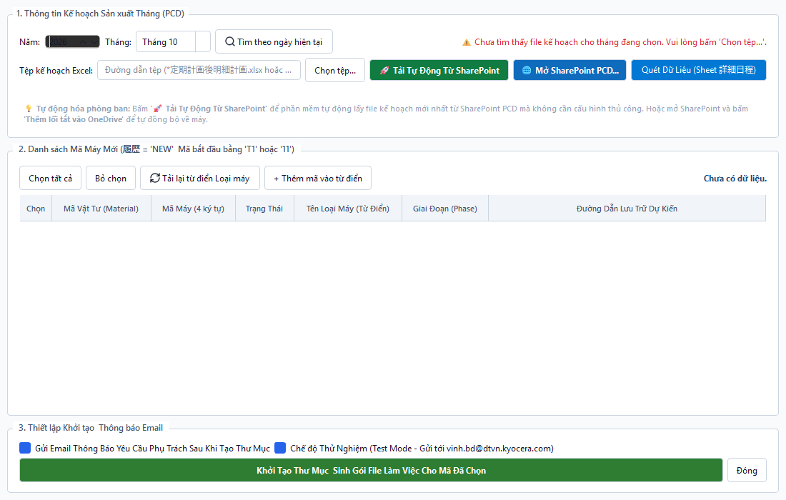

编写本文时没有真实的计划文件，因此未执行此功能。图中为无数据状态。

### 4.5 向负责人发送分工邮件

点击 1.1 中的 "Gửi Mail Phụ Trách"。软件打开邮件预览窗口（收件人、抄送、主题、HTML 正文），带有 "Mở trong Microsoft Outlook" 和 "Gửi trực tiếp qua Outlook" 按钮。

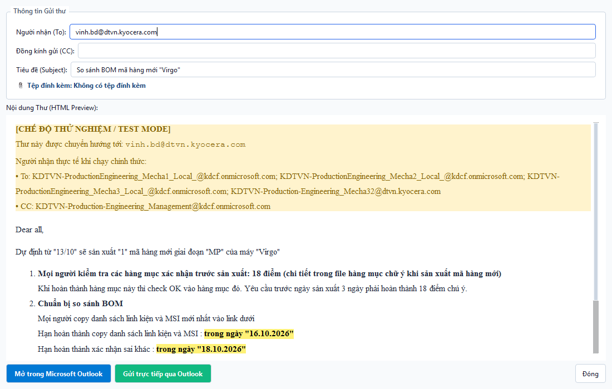

图中测试模式已开启，邮件转发给测试人员，正文开头注明了正式运行时的实际收件人。编写本文时未发送真实邮件。

### 4.6 步骤 2. 获取并处理 BOM 来源

"2.2 Bảng Trạng Thái Nguồn Dữ Liệu" 表中，PLM TC24 与 SAP R3 CS12 两列起初都显示 "Thiếu file"（缺少文件）。表格下方有按钮："Tải BOM Tự Động (PLM TC24 / SAP R3)"、"Nạp Tệp Sẵn Có Từ Ổ Đĩa"、"Lọc BOM TC24 Level 1..6 & Sao Lưu"、"Cấu Hình Bộ Lọc BOM"、"Tạo Lọc Trực Quan"、"Lọc Lại File Có Sẵn..."、"Làm mới trạng thái"。


导入来源文件有两种方式：从 PLM/SAP 自动下载（4.7），或读取磁盘上已有的文件（4.8）。

### 4.7 从 PLM (Teamcenter) 和 SAP R3 自动下载

点击步骤 2 中的 "Tải BOM Tự Động (PLM TC24 / SAP R3)"，或工具栏的 "Tải BOM (PLM/SAP)"（`Ctrl+D`）。对话框顶部有 3 步说明：

1. 把机种代码/BOM 代码列表粘贴到下方输入框。
2. 如需从 SAP R3 下载，选择生效日期（Teamcenter TC24 总是自动获取最新 BOM，不需要日期）。
3. 点击底部栏中的按钮开始下载。

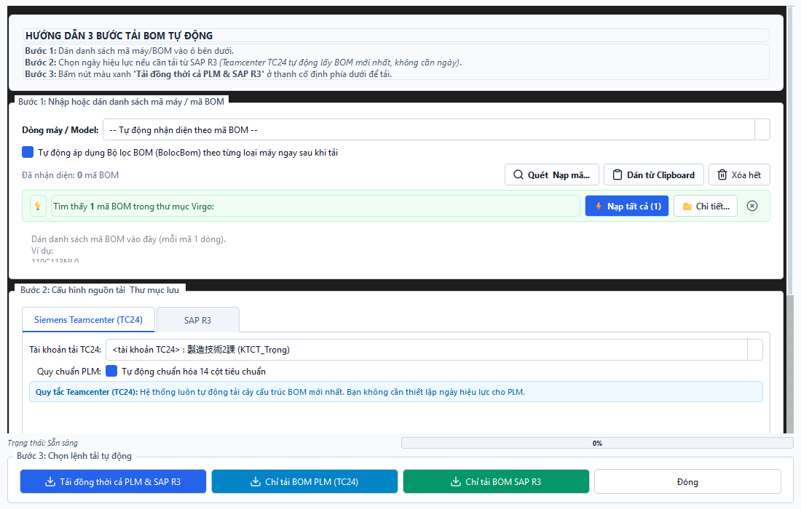

组成部分：

- "Dòng máy / Model"：默认 "Tự động nhận diện theo mã BOM"（按 BOM 代码自动识别）。
- 复选框 "Tự động áp dụng Bộ lọc BOM (BolocBom) theo từng loại máy ngay sau khi tải"（下载后立即按机种自动应用 BOM 过滤器）。
- "Quét Nạp mã..."、"Dán từ Clipboard"、"Xóa hết"：输入代码列表。机种文件夹中已有代码时，会提示 "Tìm thấy 1 mã BOM trong thư mục Virgo" 并出现 "Nạp tất cả (1)" 和 "Chi tiết..." 按钮。
- 标签页 "Siemens Teamcenter (TC24)"：TC24 账号，以及 PLM 的 "Tự động chuẩn hóa 14 cột tiêu chuẩn"（自动规范为 14 个标准列）。
- 标签页 "SAP R3"："Mã nhà máy (Plant)"、"BOM Usage"、"Alternative (Alt)"、"Ngày hiệu lực"（生效日期）。
- 底部栏："Tải đồng thời cả PLM & SAP R3"（同时下载）、"Chỉ tải BOM PLM (TC24)"、"Chỉ tải BOM SAP R3"、"Đóng"。

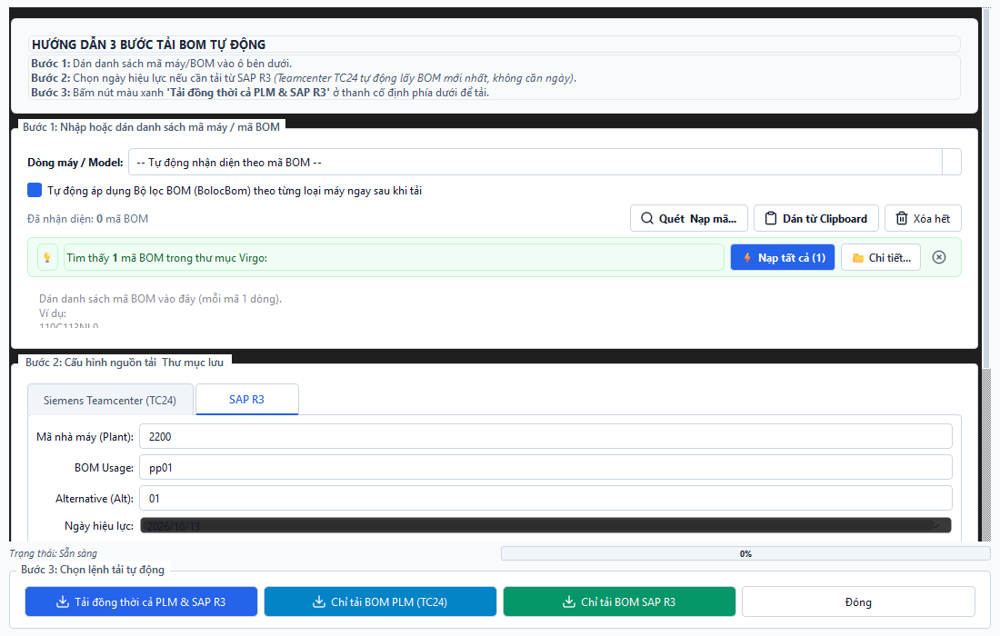

账号、密码和连接参数取自 "Cấu hình hệ thống"（3.2）。请先填写并点击 "Kiểm tra kết nối"。

**未执行：** 从 Teamcenter 和 SAP 实际下载需要账号和网络连接，因此编写本文时只打开了对话框并截图。以上说明依据实际界面，并非来自一次成功的下载。

**按文件夹或项目扫描机种代码：** "Quét Nạp mã..." 会打开扫描对话框，从某个文件夹或当前项目中识别机种代码，并显示每个代码是否已有 PLM 文件和 R3 文件。有快捷筛选 "Tất cả"、"Chỉ thiếu R3"、"Chỉ thiếu PLM"、"Đã đủ cả 2"，以及 "Lọc lại file có sẵn..." 和 "Nạp vào danh sách tải" 按钮。

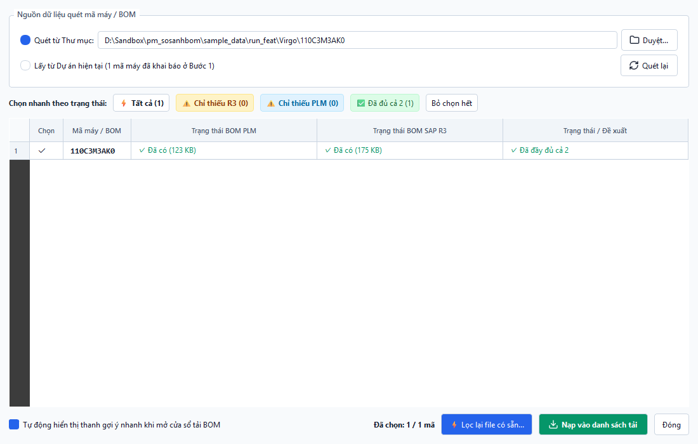

### 4.8 读取磁盘上已有的 BOM 文件

1. 点击 "Nạp Tệp Sẵn Có Từ Ổ Đĩa"，选择 PLM 文件和 R3 文件。
2. 软件提示 "Đã nạp và phân tuyến 2 tệp vào các thư mục máy tương ứng."（已将 2 个文件加载并分配到对应机种文件夹），两列变为 "Sẵn sàng"（就绪）（PLM 123 KB，R3 175 KB）。

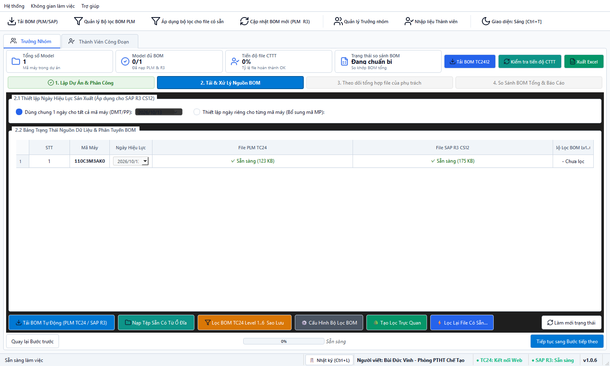

3. 点击 "Lọc BOM TC24 Level 1..6 & Sao Lưu"。软件提示 "Đã hoàn thành lọc BOM Level 1..6 và sao lưu 1 tệp vào backupTC14full/."（已完成 Level 1..6 过滤，并将 1 个文件备份到 backupTC14full/）。

本次运行中，PLM 文件过滤前 1890 行，过滤后 1878 行。


### 4.9 设置 PLM BOM 过滤器 (BolocBom)

过滤器是一份清单，列出按机种展开 PLM BOM 时需要排除的子装配/零件。点击工具栏的 "Quản lý Bộ lọc BOM PLM"，或步骤 2 中的 "Cấu Hình Bộ Lọc BOM"。

对话框构成：左侧为机种列表（带规则数，例如 Virgo 77 条规则）；右侧为规则表（零件/装配名称、匹配方式 "Chính xác (Full)"（完全匹配）或 "Chứa từ (Part)"（包含匹配）、零件代码、备注、编辑/删除按钮）；"Thêm Mới Quy Tắc Lọc"（新增规则）表单。数据集中保存在 LAN 共用数据库中（右上角的 "LAN Server (UNC)" 标识）。

底部按钮："Áp Dụng Cho File Có Sẵn..."、"Tạo Lọc Trực Quan Từ Cây BOM..."、"Nhập từ Excel (Sheet BolocBom)"、"Xuất ra Excel"、"Khôi Phục Mặc Định"、"Đóng"。

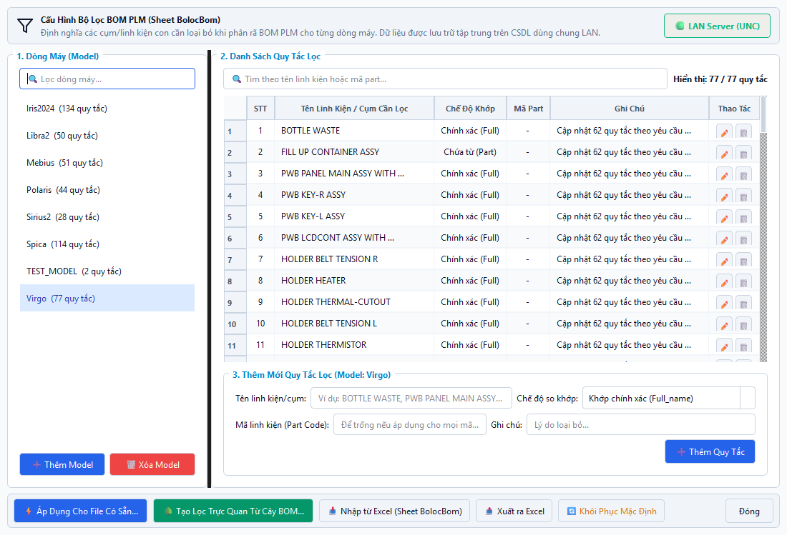

### 4.10 从 BOM 树创建可视化过滤器

点击步骤 2 中的 "Tạo Lọc Trực Quan"。对话框可以加载 PLM Full 文件（"Nạp Tệp BOM PLM Full"），按层级 (Level) 显示 BOM 树，用 "Cấp 1-2"、"Mở rộng tất cả"、"Thu gọn tất cả" 展开/折叠，搜索，并直接勾选需要排除的 Phantom 或装配。"Quy Tắc Lọc Áp Dụng" 列显示每一行当前应用的规则。底部栏显示零件总数、过滤后零件数和被规则命中的组件数；"Lưu Vào Bộ Lọc Của Model" 把选择保存为规则。

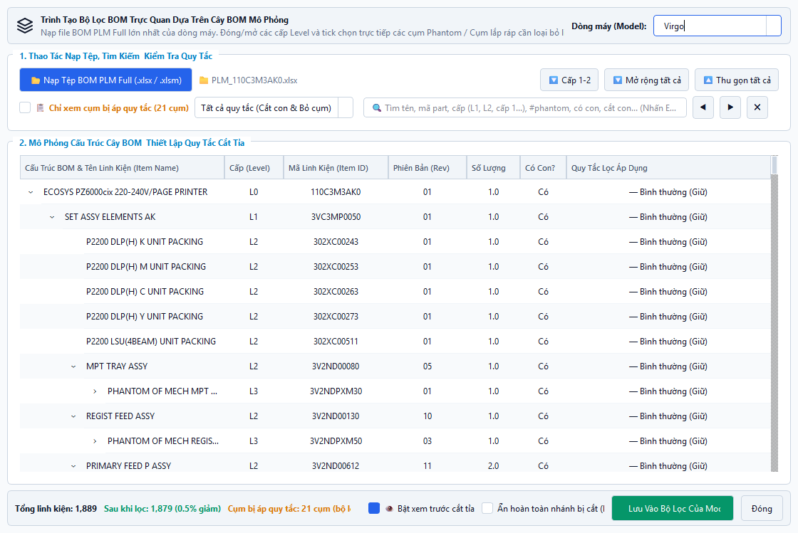

示例中，`110C3M3AK0` 的 PLM 树有 1,889 个零件；应用 Virgo 的 77 条规则后，21 个组件被规则命中，对话框中显示剩余 1,879 个零件。

### 4.11 对已有文件应用过滤器

适用于磁盘上已有 PLM 文件、只需重新运行过滤器而不必从 Teamcenter 重新下载的情况。点击工具栏的 "Áp dụng bộ lọc cho file có sẵn"，或步骤 2 中的 "Lọc Lại File Có Sẵn..."。

1. 选择来源：扫描整个文件夹，或选择一个或多个 Excel 文件。可选择是否扫描子文件夹，以及是否只识别以 "PLM_" 开头的文件。
2. 选择机种（也可由软件按文件名/文件夹名自动识别）。对话框会显示正在应用的规则数（例如 "Có 77 quy tắc đang áp dụng cho [Virgo]"）。
3. 选择写入方式："Tự động tạo bản sao lưu (.bak) trước khi cắt tỉa"（处理前自动备份），以及 "Ghi đè trực tiếp lên tệp gốc"（直接覆盖原文件）或 "Lưu thành tệp mới (*_filtered.xlsx)"（另存为新文件）。
4. 点击 "Bắt Đầu Lọc BOM"。

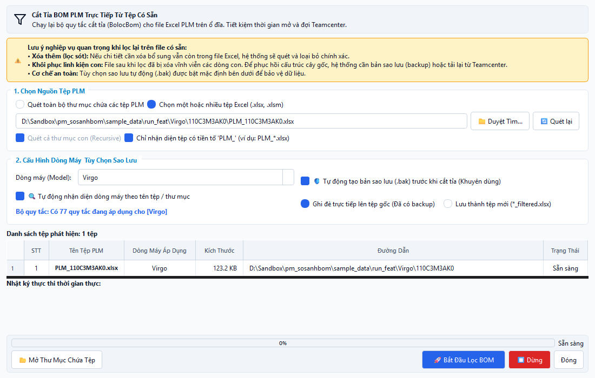

对话框中有提示：只能继续删除文件中仍存在的行；已从文件中删除的行不会自动恢复，需要用备份文件或重新从 Teamcenter 下载。

在示例 PLM 文件副本上的运行结果：

> Hoàn tất (77 quy tắc): Ban đầu 1,890 dòng -> Còn lại 1,878 dòng (Đã cắt 12 dòng linh kiện con).
> Kết thúc: Đã xử lý 1/1 tệp (1 thành công, 0 lỗi). Tổng số dòng đã cắt tỉa: 12 dòng.

（含义：完成（77 条规则）：原 1,890 行 → 剩余 1,878 行（删除 12 行子零件）。已处理 1/1 个文件（成功 1，错误 0）。共删除 12 行。）

覆盖前软件会创建备份（`PLM_110C3M3AK0_<日期时间>.xlsx`，位于 `backup_before_filter` 文件夹）。

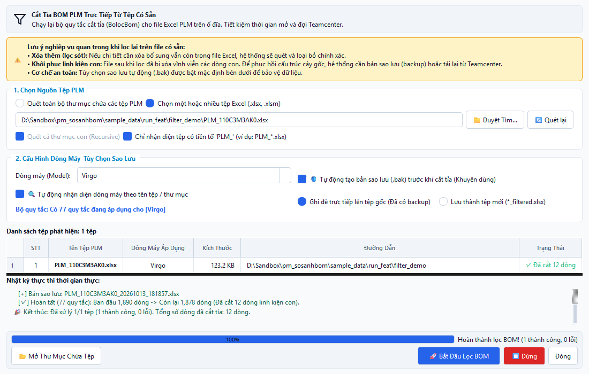

### 4.12 步骤 3. 负责人录入（"Thành Viên Công Đoạn" 界面）

此部分由各工程师在自己的电脑上完成。示例中在同一台电脑上依次用各账号操作。

1. 打开自己的分配文件（"Mở file phân công..."）。界面显示负责人、机种代码、部门，以及状态 "CHƯA HOÀN THÀNH (Q2 TRỐNG)"（未完成，Q2 为空）。
2. 在标签页 "1. Linh kiện CTTT (A:N)" 录入零件清单（"Thêm dòng" 或 "Nhập từ Excel/CSV..."）。

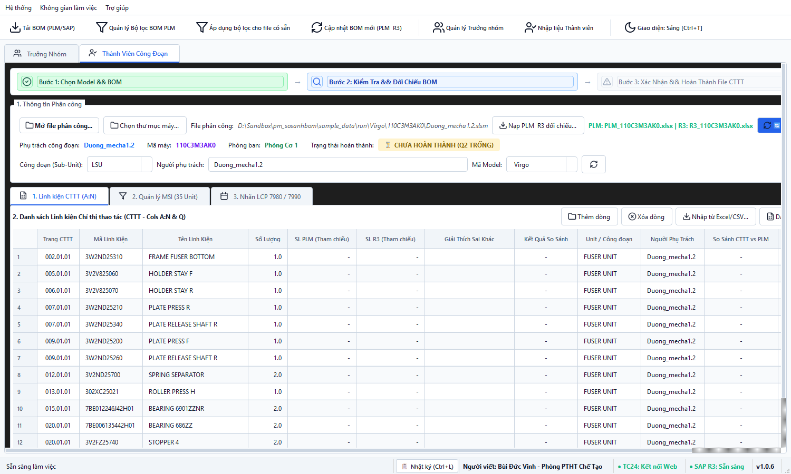

3. 点击 "Kiểm tra Sơ bộ (Self-Check PLM & R3)"，与 PLM、R3 核对数量。

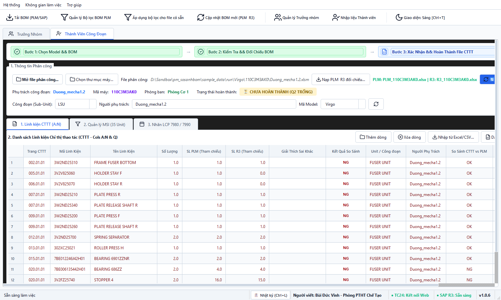

4. 点击 "Xác nhận Hoàn Thành (đóng dấu Q2 = OK)"。如果有差异零件尚未填写 "Giải thích"（说明），软件会询问是否继续。同意后提示：

> Đã đóng dấu Q2 = OK và lưu file thành công!

（已写入 Q2 = OK 并保存文件）

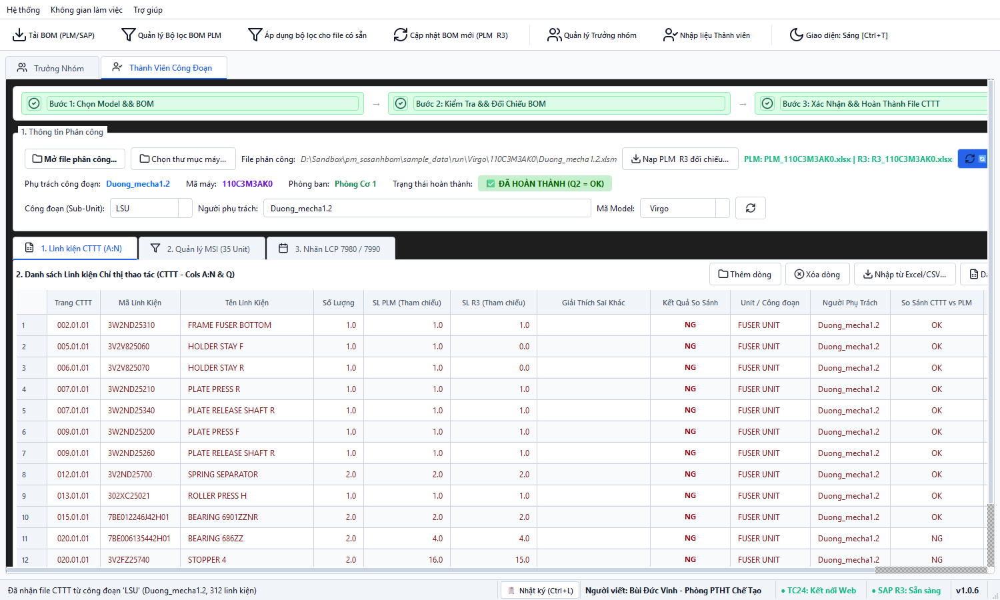

示例中 9 名负责人的零件数分别为：Duong 312、Ly 481、Nhung 356、Hung 87、VietE 109、Tu 210、Thai 281、Chien 307、Thuong 55（合计 2198）。

### 4.13 跟踪与汇总（标签页 3）

标签页 3 列出每位负责人的文件状态。点击 "Quét trạng thái ngay" 刷新。

当 9 个文件的 Q2 都为 OK 时，状态栏显示 "Hoàn tất 100% (9/9 file đạt OK). Sẵn sàng tổng hợp dữ liệu."，"TỔNG HỢP DỮ LIỆU THÀNH VIÊN" 按钮变为可点击。

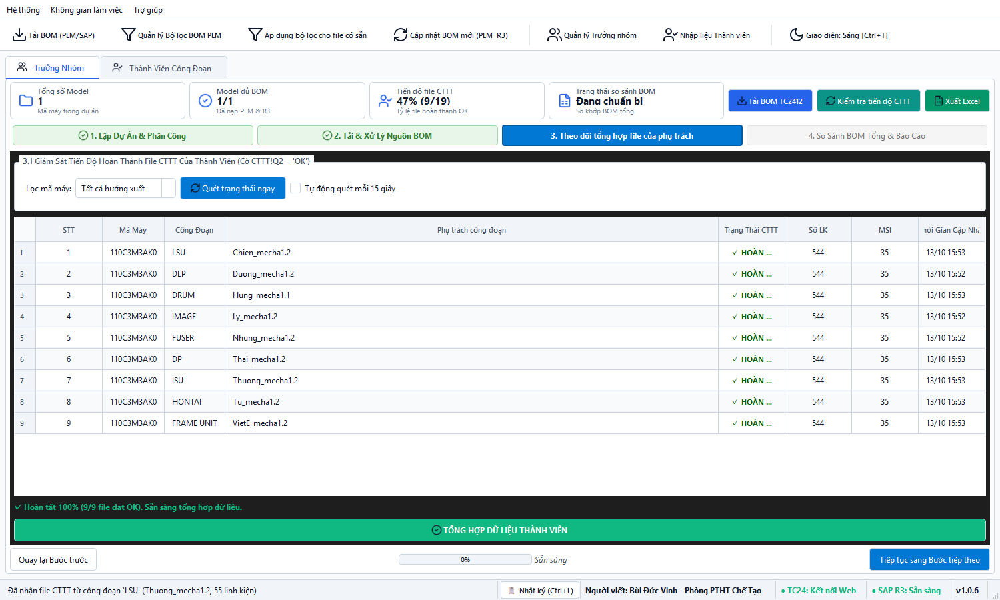

点击 "TỔNG HỢP DỮ LIỆU THÀNH VIÊN"。示例中的结果为 2198 行。从 v1.0.7 起，只有 Q2 = OK 的文件才算已提交；刚从模板创建、尚未录入零件的文件仍显示 "Chưa hoàn thành"。"Số LK" 列是实际零件数（按零件代码统计）。

### 4.14 步骤 4. 创建汇总 BOM 文件（标签页 4）

标签页 4 的 "4.1 Khởi Tạo File So Sánh BOM Tổng"，机种代码 `110C3M3AK0`。创建前状态栏显示 "Chưa tạo file BOM tổng hợp."（尚未创建汇总 BOM）。

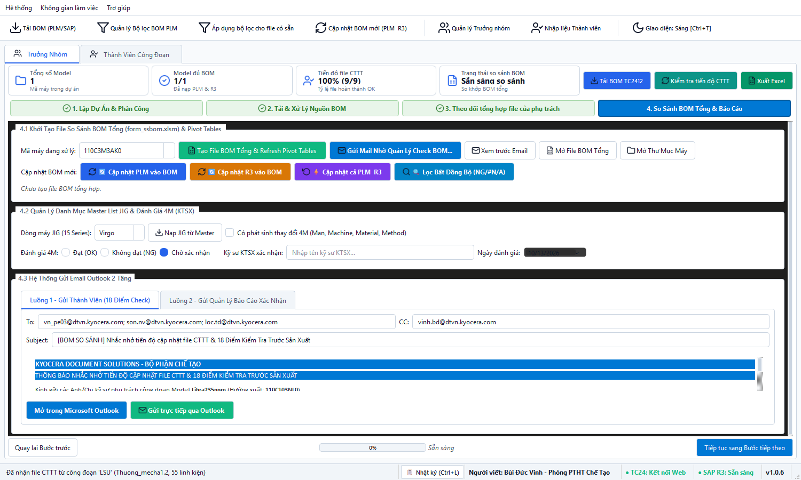

点击 "Tạo File BOM Tổng && Refresh Pivot Tables"，状态变为 "Đã tạo xong file: BOM_110C3M3AK0.xlsm (168 KB)"。

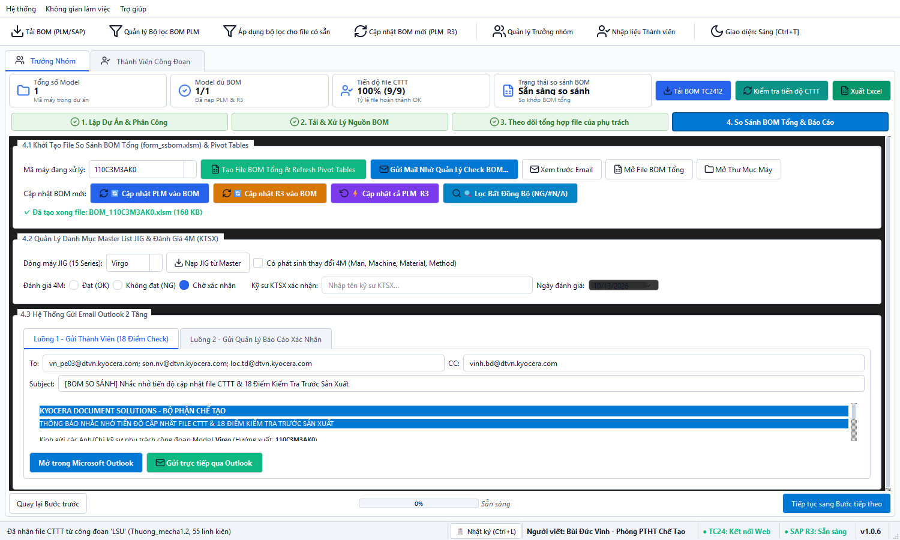

文件保存在 `Virgo\110C3M3AK0\BOM_110C3M3AK0.xlsm`。"Mở File BOM Tổng" 和 "Mở Thư Mục Máy" 可打开该文件和文件夹。

这个 168 KB 的文件是在关闭 Excel (COM) 连接的情况下生成的，未用 Excel 打开检查内容。4.15 的 BOM 更新使用的是完整的示例 BOM（带宏，3.2 MB），并使用真实的 Excel 运行。

### 4.15 把新的 PLM、R3 更新到 BOM 文件

当有新的 PLM 或 R3 文件，需要在保留说明列的同时更新到已有的 BOM 文件时使用。有两处可以点击：

- 工具栏的 "Cập nhật BOM mới (PLM & R3)"：打开专用对话框（见下文）。
- 标签页 4 中 "Cập nhật BOM mới" 一栏的三个按钮 "Cập nhật PLM vào BOM"、"Cập nhật R3 vào BOM"、"Cập nhật cả PLM & R3"：与对话框使用相同的处理程序。编写本文时没有单独点击这三个按钮。

**对话框 "Cập Nhật Dữ Liệu BOM Mới (PLM & SAP R3)" 的步骤：**

1. 选择 "Thư mục máy"（机种文件夹）（"Duyệt thư mục..."）。软件会在文件夹中查找：比较用的 BOM 文件、新的 `PLM*` 文件和新的 `R3*` 文件。刚添加文件后点击 "Quét lại"。也可用 "Chọn file..." 单独指定文件。
2. 如需保存原始文件，保持勾选 "Tự động chuyển file PLM/R3 cũ vào thư mục 'capnhat\old\'"。
3. 点击 "7. Cập nhật PLM mới"、"8. Cập nhật R3 mới" 或 "Cập nhật cả PLM & R3"。

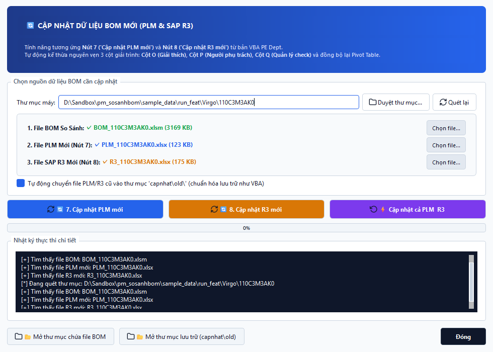

对话框中说明：此功能对应以前 VBA 版本的按钮 7 和按钮 8，并自动继承 3 列：O 列（Giải thích＝说明）、P 列（Người phụ trách＝负责人）、Q 列（Quản lý check＝管理者确认），同时重新同步数据透视表。

在示例文件上的实际运行（使用真实的 Excel，同时更新 PLM 和 R3）耗时约 52 到 65 秒：

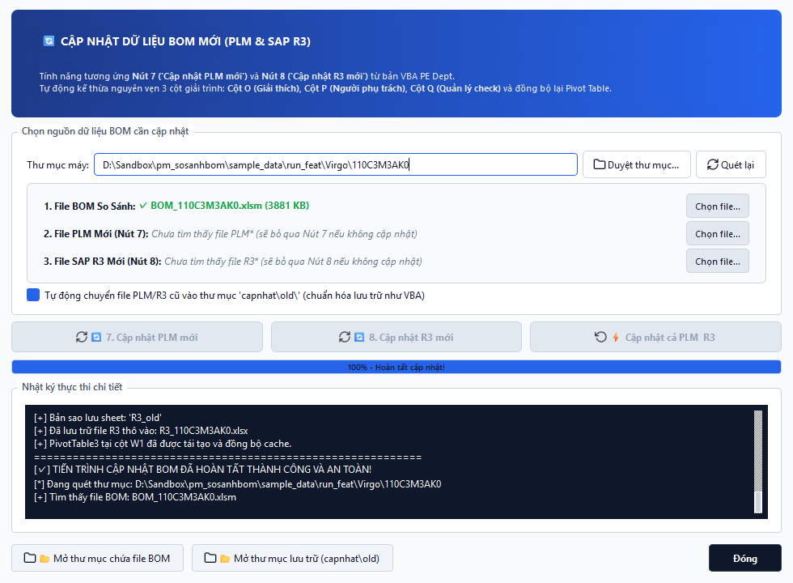

软件提示的结果：

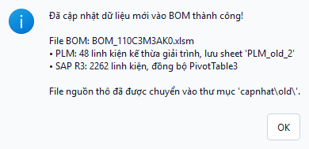

运行后检查的内容：

| 项目 | 更新前 | 更新后 |
|---|---|---|
| BOM 文件大小 | 3,245,301 字节 | 3,974,239 字节 |
| 工作表数量 | 9 | 11（新增 `PLM_old_2` 和 `R3_old`，是更新前数据的备份） |
| VBA 宏 (`vbaProject.bin`) | 有 | 有 |

- `capnhat\old\` 中有 2 份 BOM 备份（`BOM_110C3M3AK0_backup_<日期时间>.xlsm`），以及被移入的原始 PLM、R3 文件。
- 更新后（以及 4.16 过滤后）的 BOM 文件已用真实的 Excel 重新打开检查：可以打开，11 个工作表，含 VBA 工程。
- "48 linh kiện kế thừa giải trình"（继承说明的零件 48 个）是本次运行中软件显示的数字。

关于示例的说明：CTTT 工作表中的 R3 比较列，在最初的示例 BOM 和更新后都显示 `#N/A`。这里使用的 R3 文件不是直接从 SAP 导出的，因此无法对这一列下结论。未使用 SAP 实际导出的 R3 文件做过测试。

### 4.16 筛选不一致数据（NG / #N/A）

更新后，点击标签页 4 中的 "Lọc Bất Đồng Bộ (NG/#N/A)"，只保留 NG 或 #N/A 的行，隐藏 OK 的行。该按钮对当前所选机种的 BOM 文件起作用。

示例中的结果（4.15 更新之后）：

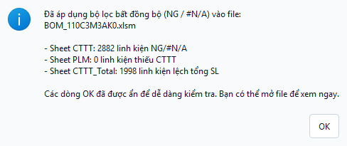

过滤后的 BOM 文件大小：3,398,897 字节。

更新并过滤后的 BOM 文件的各工作表（用真实的 Excel 以只读方式打开后截取）：

CTTT 工作表（"Compare" 列显示与 PLM 比较的结果 OK 或 NG；R3 和 REV 列如 4.15 所述显示 `#N/A`/`#REF!`）：

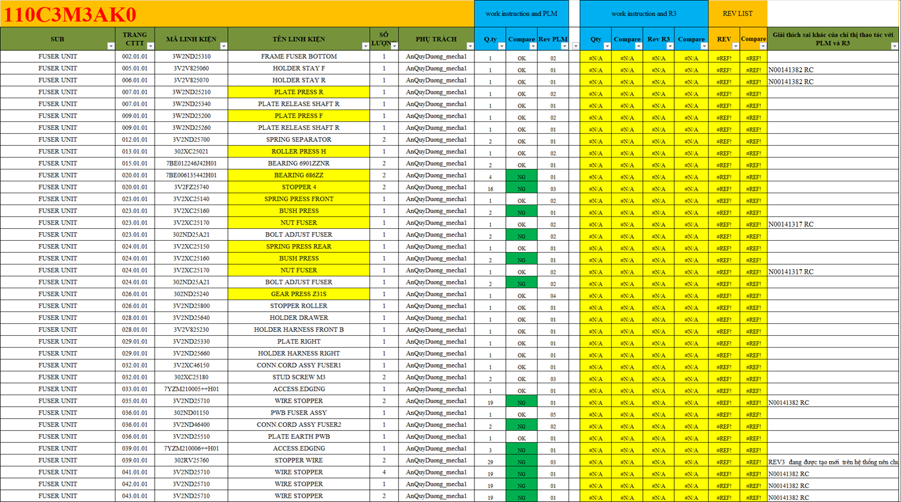

PLM 工作表（更新后的 PLM BOM，"Giải thích"（说明）和 "Phụ trách"（负责人）列被保留）：

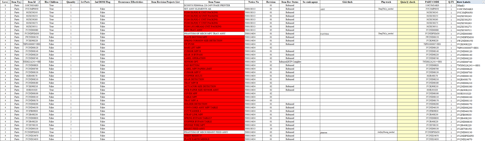

CTTT_Total 工作表（按零件代码统计的数量合计）：

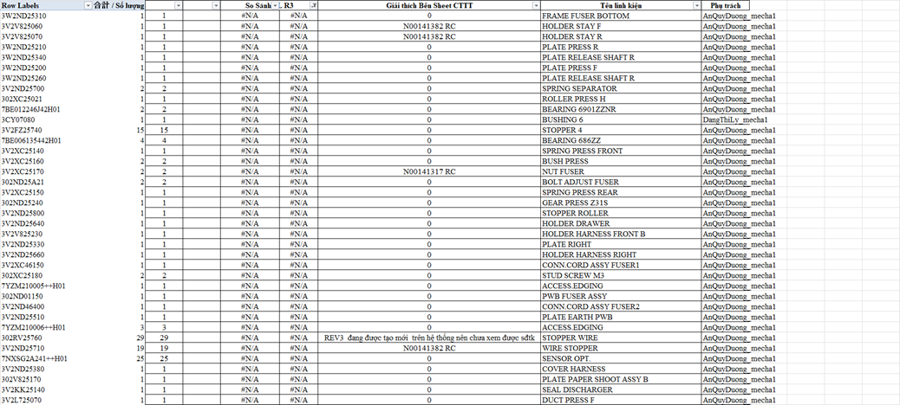

### 4.17 向管理者发送 BOM 确认邮件

点击标签页 4 中的 "Gửi Mail Nhờ Quản Lý Check BOM..."。软件打开发给管理者的邮件预览，汇总 BOM 作为附件，带有 "Mở trong Microsoft Outlook" 和 "Gửi trực tiếp qua Outlook" 按钮。"Xem trước Email" 按钮可查看 "4.3 Hệ Thống Gửi Email Outlook 2 Tầng"（两级 Outlook 邮件）中两条流程的内容（流程 1：向成员提醒 18 项检查；流程 2：向管理者报告确认）。

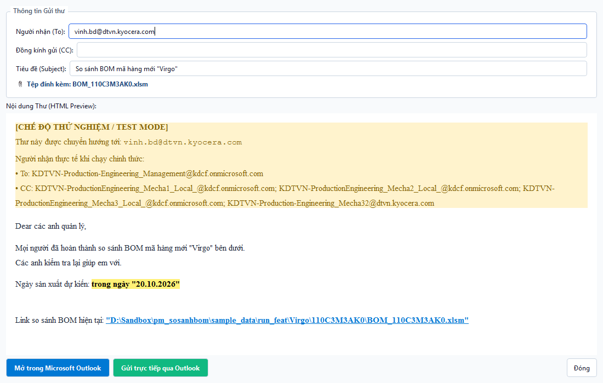

图中测试模式已开启。编写本文时未发送真实邮件。

### 4.18 JIG 与 4M 评估（4.2 栏）

标签页 4 的 "4.2 Quản lý Danh Mục Master List JIG & Đánh Giá 4M (KTSX)" 有：选择 JIG 机种、"Nạp JIG từ Master" 按钮、"Có phát sinh thay đổi 4M (Man, Machine, Material, Method)" 复选框、4M 评估（Đạt OK／Không đạt NG／Chờ xác nhận）、KTSX 确认工程师栏和评估日期（见 4.14 的图）。编写本文时未执行此功能。

## 5. 编写本文时已执行与未执行的项目

| 功能 | 状态 |
|---|---|
| 建立项目、创建文件夹、分工（步骤 1） | 已实际执行 |
| 读取磁盘文件、BOM Level 1..6 过滤（步骤 2） | 已实际执行 |
| 成员录入、Self-Check、确认 Q2 = OK（步骤 3） | 已用 9 个账号实际执行 |
| 汇总成员数据（步骤 3） | 已实际执行（2198 行） |
| 创建汇总 BOM 文件（步骤 4） | 已执行（关闭 Excel COM）；未打开文件检查 |
| 把 PLM、R3 更新到 BOM（真实 Excel） | 已实际执行，并用 Excel 重新打开检查 |
| 筛选不一致数据（NG/#N/A） | 已实际执行 |
| 对已有文件应用过滤器 | 已在副本上实际执行 |
| 过滤器设置、可视化过滤器、机种代码扫描、Model/人员管理、系统设置、切换主题 | 仅打开并截图；未改动数据 |
| 从 Teamcenter 和 SAP 自动下载 | 未执行（需要账号和网络） |
| 用真实计划文件扫描 PCD | 未执行 |
| 通过 Outlook 发送真实邮件 | 未执行 |
| 4.2 栏 JIG／4M | 未执行 |
| 软件自动更新（下载与安装） | 未重新执行；对话框是为截图而构建 |

## 6. 备注

- 成员界面：Self-Check 之后，即使 PLM 与 R3 数量一致的行，"Kết Quả So Sánh" 列也可能显示 NG。原因尚未确认；遇到时请联系软件负责人。
- 暗色主题：组长界面中未选中的步骤标签页显示为浅色背景、灰色文字。仍可阅读，但与暗色主题的其余部分不一致。
- 测试模式开启时，发出的邮件会转发给测试人员。正式使用前请在 "Cấu hình hệ thống" → "Email Mẫu Form" 标签页中检查。
